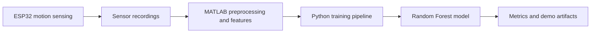

# GestureFusion

<p align="center">
  <strong>Gesture interaction across embedded sensing, signal processing, and machine learning</strong><br/>
  An exploratory ESP32 + MATLAB + Python prototype.
</p>

<p align="center">
  <a href="https://github.com/HarshithhKumar/GestureFusion/actions/workflows/ci.yml"></a>
  
  
  
  
</p>

GestureFusion explores how motion input can move from a sensor to a software classifier. The repository brings together embedded sensing concepts, MATLAB signal-processing materials, and a Python training workflow.

> **Current status:** The Python training pipeline uses synthetic data. Its metrics validate the workflow, not real-world gesture-recognition accuracy.

## System overview



The stages describe the intended integration path; the synthetic training workflow currently allows the ML portion to be exercised independently of a real recorded dataset.

## What's included

- **Hardware:** ESP32 firmware and notes in [hardware/](hardware/).
- **Signal processing:** MATLAB scripts and feature-extraction materials in [matlab/](matlab/).
- **Python package:** data utilities and experiment helpers in [src/gesturefusion/](src/gesturefusion/).
- **Training:** synthetic-data generation, train/test split, Random Forest classification, and saved artifacts.
- **Exploration:** a static dashboard and notebook walkthrough.

## Quick start

Requirements: Python and pip.

```bash
git clone https://github.com/HarshithhKumar/GestureFusion.git
cd GestureFusion
pip install -r requirements.txt
python train.py
pytest -q
```

The training workflow writes a model artifact and metrics report to [artifacts/](artifacts/).

Explore the demo materials:

- [Dashboard](dashboard/index.html)
- [Notebook walkthrough](notebooks/GestureFusion_demo.ipynb)

## Repository layout

```text
hardware/             ESP32 firmware and hardware notes
matlab/               Signal processing and feature extraction
src/gesturefusion/    Python utilities and experiment helpers
notebooks/            Demo notebook
dashboard/            Static sensor-data visualization
assets/               Project visuals
artifacts/             Generated model and metrics
tests/                Automated tests
```

## Training workflow

1. Generate a synthetic gesture dataset.
2. Split the data into training and test sets.
3. Train a Random Forest classifier.
4. Save the model and evaluation metrics.

Because the input data is synthetic, high test scores would not establish performance on actual hand or body gestures. A meaningful next milestone is to record real sensor sequences, document the feature pipeline, and evaluate on a held-out set of recordings.

## Next steps

- Add a documented real-sensor dataset and reproducible recording instructions.
- Report class-level metrics and a confusion matrix on held-out recordings.
- Connect live sensor capture to inference once the data pipeline is validated.
- Explore real-time interaction or audio/MIDI output after establishing a reliable baseline.

## License

Educational and portfolio demonstration project.
